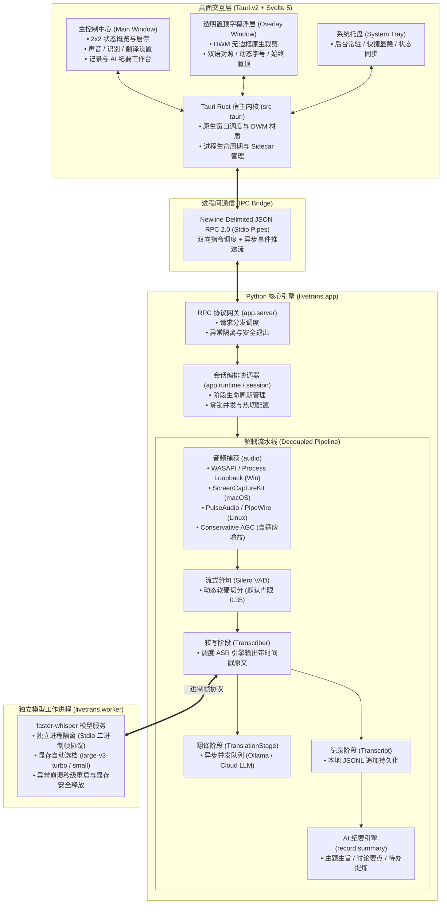

# LiveTrans 架构

LiveTrans 采用**三层异构多进程架构**：前端桌面壳体（Rust / Webview）、计算调度中枢（Python Sidecar）与推理工作进程（Model Worker）分层协作。




## 目录结构

```
live-trans/
├── desktop/                       # Tauri v2 桌面客户端
│   ├── src/                       # Svelte 5 前端工程
│   │   ├── main/                  # 主控制中心 (概览、音频、ASR、翻译、记录、外观)
│   │   ├── subtitle/              # 置顶悬浮双语字幕浮层
│   │   ├── lib/                   # 状态管理、主题色生成与 JSON-RPC 桥接
│   │   └── assets/                # 应用图标与矢量静态资源
│   ├── src-tauri/                 # Tauri Rust 原生宿主
│   │   ├── src/lib.rs             # 窗口创建与应用装配
│   │   ├── src/tray.rs            # 系统托盘与菜单
│   │   ├── src/appearance.rs      # 原生窗口材质与系统外观（DWM）
│   │   ├── src/core.rs            # Python Sidecar 进程生命周期与管道通信
│   │   ├── Cargo.toml             # Rust 依赖清单
│   │   └── tauri.conf.json        # Tauri 窗口与安全权限配置
│   └── package.json               # 前端依赖配置
│
├── livetrans/                     # Python 核心计算中枢
│   ├── app/                       # RPC 服务端、控制器与运行时协调
│   │   ├── server.py              # Newline-Delimited JSON-RPC 2.0 服务端
│   │   ├── controller.py          # 应用状态与设置操作分发
│   │   ├── runtime.py             # 会话生命周期与串行异步状态机
│   │   └── records.py             # 记录存盘与历史管理服务
│   ├── audio/                     # 跨平台系统音频环回与捕获
│   │   ├── windows/               # WASAPI 与 Process Loopback API (Windows)
│   │   ├── macos.py               # ScreenCaptureKit (macOS)
│   │   ├── linux.py               # PulseAudio / PipeWire (Linux)
│   │   └── vad.py                 # Silero VAD 动态流式分句与 Conservative AGC
│   ├── asr/                       # 语音识别抽象与本地/云端客户端
│   ├── translate/                 # 实时翻译抽象、并发队列与 OpenAI 兼容适配
│   ├── record/                    # 会话持久化与 AI 会议纪要生成引擎
│   ├── worker/                    # 独立 Whisper 模型运行时与进程帧协议
│   ├── session.py                 # 阶段串联与事件调度装配
│   ├── transcriber.py             # 声音采集 → VAD → ASR 解耦流水线
│   └── config.py                  # 配置模型与原子保存
│
├── scripts/                       # 辅助诊断与开发排查工具
├── tests/                         # 自动化单元测试套件
├── packaging/                     # 发行依赖锁定与安装打包脚本
├── start.bat                      # Windows 一键编译并启动脚本
└── pyproject.toml                 # Python 项目元数据与依赖定义
```

用户文档见 [README](../README.md)，构建与发布见 [releasing.md](releasing.md)。
